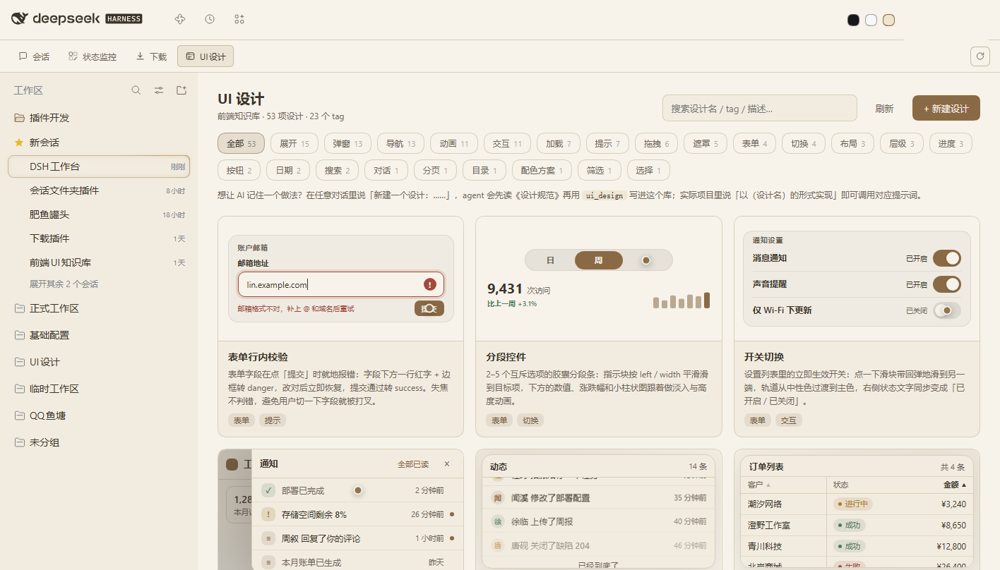

# DSH Workbench

English README. 中文版见 [README.md](README.md).


A tabbed workspace shell for [DeepSeek Harness](https://github.com/deepseek-ai/deepseek-harness). Each module is one page in a second top-bar row — status monitor, download center, or anything you build against the same small contract.



## Why

DeepSeek Harness ships a conversation-centric Web UI. This project turns it into a workspace: a fixed system bar on top (brand, global icons, account, balance, restart), a workbench switcher underneath, and the conversation area below. Every module gets a full page of the central area while the session list on the left keeps working.

The shell is deliberately thin — it owns layout, the tab row and a handful of UI primitives. Modules own their data and their page. They never import each other, and they talk to the shell through one runtime service.

## Packages

| package | what it is |
|---|---|
| [`@philomelcc/dsh-workbench`](packages/workbench) | the shell: module API, top bar, tab switcher, overview page, shared components |
| [`@philomelcc/dsh-status-monitor`](https://github.com/philomelcc/dsh-status-monitor) | disk / hardware / ports / usage cards with a full-page zoom |
| [`@philomelcc/dsh-downloads`](https://github.com/philomelcc/dsh-downloads) | download queue with aria2 + Xunlei backends, magnet links, session history |

The last two are plugins in **their own repositories**; this repo only ships the shell. They do not need it: with the workbench installed they appear as tabs, without it they become native sidebar entries on their own.

[`packages/port-monitor`](packages/port-monitor) is an in-repo example (`private`, not published to npm): it shows what a complete minimal module package looks like. To start a module, copy [`template/`](template).

## Install

```powershell
dsh plugin --profile web add @philomelcc/dsh-workbench
dsh plugin --profile web add @philomelcc/dsh-status-monitor
dsh plugin --profile web add @philomelcc/dsh-downloads
```

Restart the Web UI once. The workbench tabs appear on the second top-bar row. Details, manual install and troubleshooting are in [docs/getting-started.md](docs/getting-started.md).

Extra dependencies a module needs (aria2 for the download center, for example) are documented in that module's own README.

## Build a module

The whole contract is one page: [docs/SPEC.md](docs/SPEC.md).

```js
const wb = ctx.get('workbench');
if (!wb || wb.apiVersion !== 1) return;

ctx.effect(() => wb.registerView({
  id: 'my-module',
  title: '我的模块',
  component: MyView,
  order: 50,
}), 'my-module: view');
```

Copy [`template/`](template) to start, or read [`packages/port-monitor`](packages/port-monitor) as a complete example (it is private and not published to npm). Shell and modules version independently: a module built for `apiVersion 1` keeps working across shell releases that still report `1`.

## Repository layout

```
packages/workbench         the shell bundle
packages/port-monitor      example module (private, not published)
template/                  copy-me starting point for a new module
docs/                      SPEC, getting started, module registry, publishing
scripts/check.mjs          node --check across every shipped script
```

## Notes

- Windows is the primary target: port and disk sampling read Windows data. The shell and the module API are platform-neutral.
- `npm run check` syntax-checks every shipped script; CI runs it on Linux and Windows.
- Plugins are installed into a DSH profile; nothing here patches the Harness itself.

## License

MIT.
