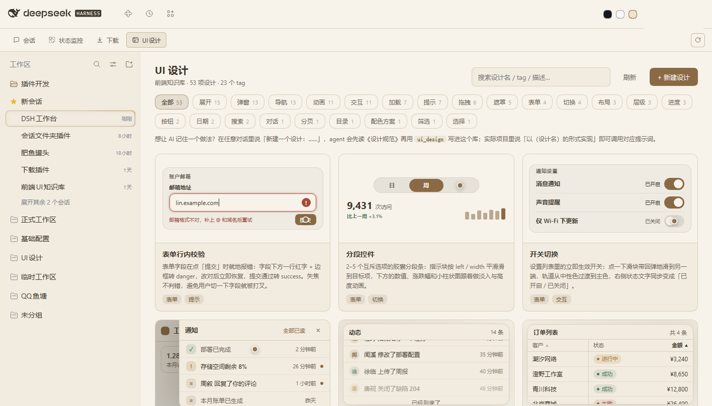

# DSH 工作台


给 [DeepSeek Harness](https://github.com/deepseek-ai/deepseek-harness) 加一层带标签页的工作区外壳。顶部第二行是工作台切换页，每个模块占一整页——状态监控、下载中心，或者你按同一份契约写的任何页面。



## 为什么

DeepSeek Harness 的 Web UI 以会话为中心。这个项目把它变成工作区：顶部固定系统栏（品牌、全局图标、账号、余额、重启），下面是工作台切换页，再往下是会话区。每个模块拿到中央区域的整页，左侧会话列表照常可用。

外壳刻意做得很薄——只负责布局、标签行和几个 UI 原语。模块自己管数据、自己画页面，彼此不 import，只通过一个运行时服务跟外壳对话。

## 包含的包

| 包 | 说明 |
|---|---|
| [`@philomelcc/dsh-workbench`](packages/workbench) | 外壳：模块 API、顶部栏、标签切换、总览页、公共组件 |
| [`@philomelcc/dsh-status-monitor`](https://github.com/philomelcc/dsh-status-monitor) | 磁盘 / 硬件 / 端口 / 用量四张卡片，支持放大到整页 |
| [`@philomelcc/dsh-downloads`](https://github.com/philomelcc/dsh-downloads) | 下载队列（aria2 + 迅雷双引擎）、磁力链接、会话下载记录 |

后两个是**独立仓库里的插件**，本仓库只提供外壳。它们不依赖外壳：装在工作台里就出现在顶部标签栏，没装工作台时自己就是原生侧栏里的入口。

另外 [`packages/port-monitor`](packages/port-monitor) 是仓库内的示例模块（`private: true`，不发 npm）：它演示一个最小完整的模块包长什么样，想直接复制的话用 [`template/`](template)。

## 安装

```powershell
dsh plugin --profile web add @philomelcc/dsh-workbench
dsh plugin --profile web add @philomelcc/dsh-status-monitor
dsh plugin --profile web add @philomelcc/dsh-downloads
```

装完重启一次 Web UI，标签就出现在顶部第二行。手动安装、故障排查见[《快速开始》](docs/getting-started.md)。

模块自己的额外依赖（比如下载中心要的 aria2）写在各自仓库的 README 里，装那个模块时再看。

## 写一个模块

完整契约就一页：[docs/SPEC.md](docs/SPEC.md)。

```js
const wb = ctx.get('workbench');
if (!wb || wb.apiVersion !== 1) return;

ctx.effect(() => wb.registerView({
  id: 'my-module',
  title: '我的模块',
  component: MyView,
  order: 50,
}), 'my-module: view');
```

从 [`template/`](template) 复制起步，或者直接读 [`packages/port-monitor`](packages/port-monitor) 这个最小完整例子（它不发布到 npm，只在仓库里当参考）。外壳和模块独立发版：按 `apiVersion 1` 写的模块，在仍然声明 `1` 的外壳上都能用。

## 仓库结构

```
packages/workbench         外壳
packages/port-monitor      示例模块（私有，不发布）
template/                  复制即用的模块起点
docs/                      契约、快速开始、模块登记、发布流程
scripts/check.mjs          对全部脚本跑 node --check
```

## 说明

- 主要面向 Windows：端口和磁盘采样读的是 Windows 数据。外壳和模块 API 本身跨平台。
- `npm run check` 对所有要发布的脚本做语法检查，CI 在 Linux 和 Windows 各跑一次。
- 插件装进 DSH 的 profile，不会改动 Harness 本体。
- 英文版 README 见 [README.en.md](README.en.md)。

## 许可证

MIT。
