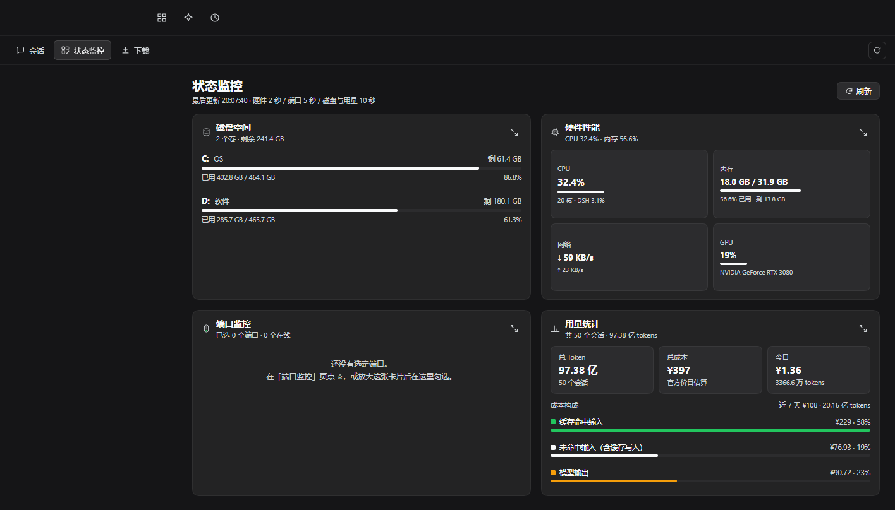

# @philomelcc/dsh-status-monitor

Workbench module: four live cards — disk, CPU/memory/GPU, ports, session usage —
each expandable to the full central area.



## Install

```powershell
dsh plugin --profile web add @philomelcc/dsh-workbench
dsh plugin --profile web add @philomelcc/dsh-status-monitor
```

Restart the Web UI; the module adds the **状态监控 / Status** tab.

## What it reads

| card | source |
|---|---|
| Disk | `fs.statfs` per volume |
| CPU / memory | `os` sampling, one tick per 2 s |
| GPU | `nvidia-smi` when present, silently skipped otherwise |
| Ports | its own `/wb/status/ports` route (fast path, separate from the port monitor's slower scan) |
| Usage | session token/cost data folded from the local session log |

All sampling happens in the Host half on Windows; endpoints live under
`/wb/status/...` and answer loopback only.

## Requirements

Windows for the full set (process/disk telemetry). The page degrades card by
card: a missing endpoint shows "unavailable" in that card only.

MIT.
